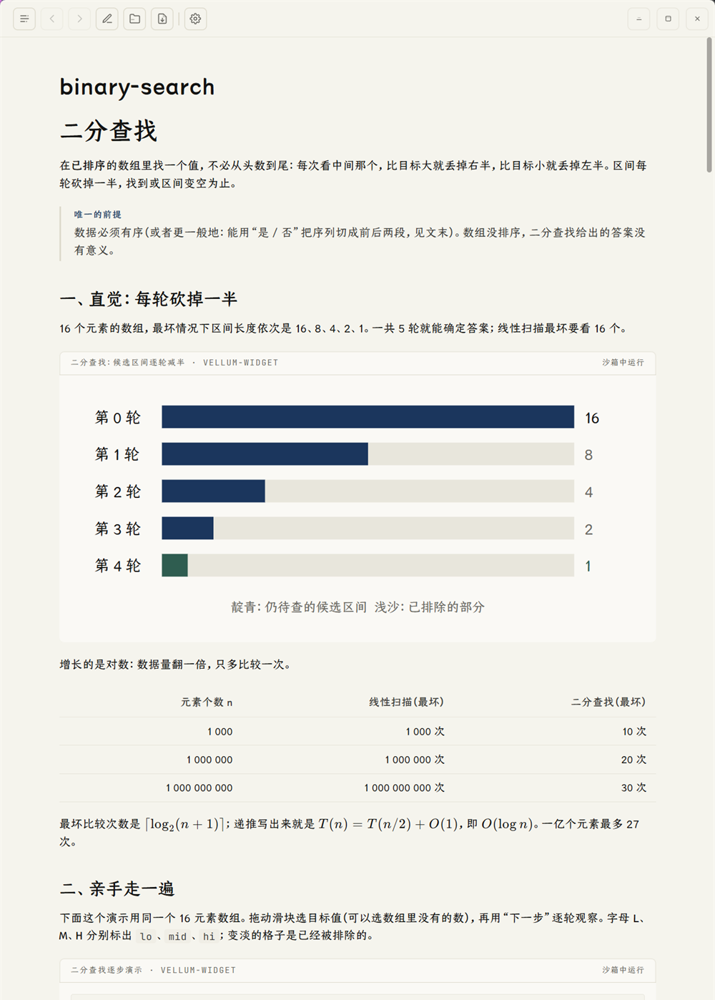
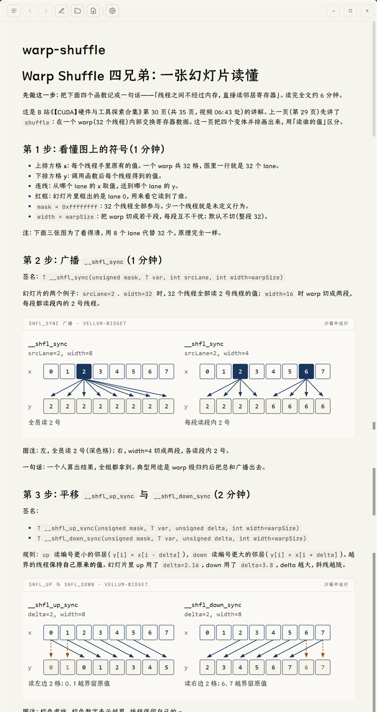

# 让 Agent 写出带图和演示的 Markdown：`vellum-widget-md`

在 Vellum 仓库里启动 pi，对 Agent 说：

```text
用 vellum-widget-md 写一篇二分查找的讲解，保存到 samples/binary-search.md。
```

普通 Markdown 讲不清的结构、流程或「拖一下看会怎样」，可以写进文档里的 `vellum-widget` 围栏，由 Vellum 渲染成 SVG 图示或可交互演示。`vellum-widget-md` 是仓库内置的 pi 技能（由 `.pi/settings.json` 自动加载，源码在 [`pi/skills/vellum-widget-md/`](../pi/skills/vellum-widget-md/)），教 Agent 何时画图、如何起草、怎样用脚本自检并交付。

> **在 GitHub 上查看时的说明**：图与演示由 Vellum 沙箱渲染，GitHub 只会把围栏显示为代码块。下方用截图展示实际渲染效果；要亲自交互，请用 Vellum 打开 [`samples/`](../samples/) 中的示例文档。

## 效果示例

以下两篇文档均由 Agent 按本技能一次写成，未经手工修改：

1. **[二分查找（`samples/binary-search.md`）](../samples/binary-search.md)**：用一张静态条形图对比「每轮减半」，配一个可拖动步进的交互式查找演示，加公式、表格、代码与练习。



2. **[Warp Shuffle 四兄弟（`samples/warp-shuffle.md`）](../samples/warp-shuffle.md)**：把一页 CUDA 幻灯片拆成四步，用三张静态图并排对比 `shfl` / `up` / `down` / `xor` 四个原语的线程取值连线。



## 在 Vellum 中打开与授权

用 Vellum 打开生成的 `.md` 文件后：

- **静态 SVG 图**直接显示，无边框、不拦截滚轮。
- **交互式演示**首次停在「交互内容 · 点击加载」门禁上；点击一次后，Vellum 会按源码指纹记住授权，此后热重载、切换文档或重启应用都自动加载。

## 五步工作流

技能要求 Agent 按固定五步执行，每步都有可检验的完成标准：

| 步骤 | 动作 | 完成判据 |
|---|---|---|
| 1. 选形态 | 在四级能力阶梯中选最低够用的一级 | 明确命名所选形态，并说明更低层级为何不够用 |
| 2. 起草 | 从内置模板起手，写入临时 HTML 草稿 | 草稿文件存在，以 `<!DOCTYPE html>` 开头 |
| 3. 自查 | 先查语义（箭头方向、标签含义），再查几何（字出框、线穿字） | 逐项核对通过 |
| 4. 机检 | 运行 `check-widgets.mjs`（内部联动 `svg-lint.mjs`） | 退出码为 0，警告逐条清零或解释 |
| 5. 交付 | 嵌入 `vellum-widget` 围栏并整篇复检 | 整篇通过校验，提示读者首次点击加载 |

### 能力阶梯：能用低一级，不上高一级

| 形态 | 适用场景 | 边界与限制 |
|---|---|---|
| 原生 Markdown | 表格、KaTeX 公式、callout、任务列表、代码高亮 | 无法表达空间拓扑与动态参数 |
| 内联 HTML | `<details>` 折叠、`<kbd>`、`<mark>`、上下标 | `style`、`<svg>`、`<button>` 等会被安全白名单剥离 |
| 静态 widget | 结构图、流程图、时序图、对比图、数据分布条形图 | 纯展示，不随用户输入变化 |
| 交互 widget | 参数调节、步进演化、拖拽探索（每篇至多 1 个） | 断网、无持久化存储（内存态运行） |

### 校验脚本查什么

每个 `vellum-widget` 都是跑在跨源隔离沙箱里的自包含 HTML5 文档。为了避免「不报错但显示空白或高度塌缩」，可单独运行校验脚本对任意 Markdown 或草稿做静态体检：

```bash
node pi/skills/vellum-widget-md/tools/check-widgets.mjs samples/binary-search.md
```

脚本会拦截以下常见问题：

1. **围栏与体积**：围栏名误写为 `html`、反引号未配平，或单块超过 512KB。
2. **高度通信与动效**：缺失 `vellum-widget-resize` 高度上报 IIFE，或漏写 `prefers-reduced-motion` 退路。
3. **沙箱禁区**：引用外部 CDN / 网络请求（被 CSP 拦截），或读写 `localStorage` / `sessionStorage` / `document.cookie`（在无源沙箱中直接抛 `SecurityError`）。
4. **排版与几何（`svg-lint`）**：字号小于 11px、夹带 emoji、文字溢出矩形框、连线穿过文字、节点重叠。

## 适用边界

- **适用**：将在 Vellum 中阅读的教程、算法讲义、架构图解、交互式实验笔记。
- **不适用**：面向通用平台（GitHub、普通编辑器）的仓库文档（如 `README.md`、`docs/`）或纯文字随手记——在非 Vellum 环境中围栏只会退化为普通代码块。
- **实时对话分支（mdlog）**：当 pi 已通过 `/mdlog` 连接到日志文件时，工具表中会自动激活 `vellum_figure` 工具，Agent 会改用该工具投递图示，避免几 KB 的 HTML 源码刷屏对话流。

## 延伸阅读

| 主题 | 文档路径 |
|---|---|
| 技能主入口与五步流程 | [`pi/skills/vellum-widget-md/SKILL.md`](../pi/skills/vellum-widget-md/SKILL.md) |
| 契约 1–7（围栏、沙箱、配色、授权、几何） | [`references/widget-contracts.md`](../pi/skills/vellum-widget-md/references/widget-contracts.md) |
| 交互演示设计准则与四套配方 | [`references/interaction-patterns.md`](../pi/skills/vellum-widget-md/references/interaction-patterns.md) |
| 常见症状 → 根因 → 修法速查表 | [`references/troubleshooting.md`](../pi/skills/vellum-widget-md/references/troubleshooting.md) |
| mdlog 实时日志专属规则 | [`references/mdlog-live.md`](../pi/skills/vellum-widget-md/references/mdlog-live.md) |
